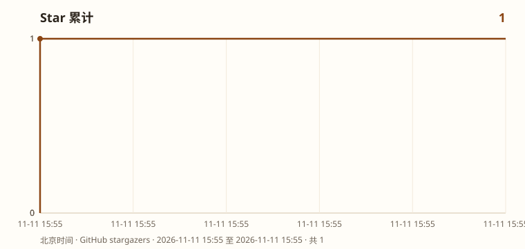

## 赞助商：[ChainFuel](https://chainfuel.tap365.org/)

**ChainFuel 提供稳定、低价的大模型接口。** 在现有工具里填一把密钥和 Base URL，按 OpenAI 兼容方式调用 GPT、Claude、Grok、Gemini、GLM、Kimi、DeepSeek。

**注册福利：余额 2 刀 + 5 刀订阅体验。现在邀请新用户购买，赠送一个月订阅套餐。**

# mason

浏览器里直接玩的第一人称射击。切断港区三处中继，突破封锁，登船撤离。

在线试玩：<https://3a.mwcpool.uk/>

原作地址：<https://claude.ai/artifact/BGY1SztrAYcJQHSsnHHGmp>

开源地址：<https://github.com/mason0510/china-3a-claude>

## 本地打开

整页是一个静态文件，没有构建步骤。`index.html` 里已经带上渲染和关卡。`sw.js` 是离线回退用的 service worker，只在 http(s) 页面上注册。

```bash
python3 -m http.server 8080
```

然后打开 <http://127.0.0.1:8080/>。用 `file://` 直接双击时，service worker 不会生效，游戏本身仍可玩。

## 操作

| 键 | 作用 |
|---|---|
| WASD | 移动 |
| 鼠标 | 视角 |
| 左键 / `/` / `\` | 开火。鼠标模式下屏幕也有「开火」 |
| 右键 | 瞄准 |
| R | 换弹 |
| E | 切断中继 |
| Space / Shift / C | 跳 / 冲刺 / 蹲 |
| Esc | 暂停 |
| 新手辅导 | 同一张地图，不刷机械飞鸥和机械猎犬 |

触屏用左手移动、右手转视角，不显示鼠标用的「开火」按钮。`/` 和 `\` 是在原有按键上加的，L 仍是向右转，P 仍是暂停。输入法要切到英文，`/` 才会进到游戏。设置里可以改画质、灵敏度和视野。

分辨率按屏幕、像素比和是否触屏选取。卡顿时会自动降一档，并记在本页内存、当前标签和本机三层缓存里。

## 许可

[Apache License 2.0](LICENSE)。

## Star History

[](https://github.com/mason0510/saltline/stargazers)



曲线由 `python3 scripts/update_star_history.py <stargazers.tsv>` 重画。仓库里没有定时函数，不跑这句，图就停在上次写出的数字。

怎么把这一页拆回系统说明，见 [analyze](analyze/README.md)。
